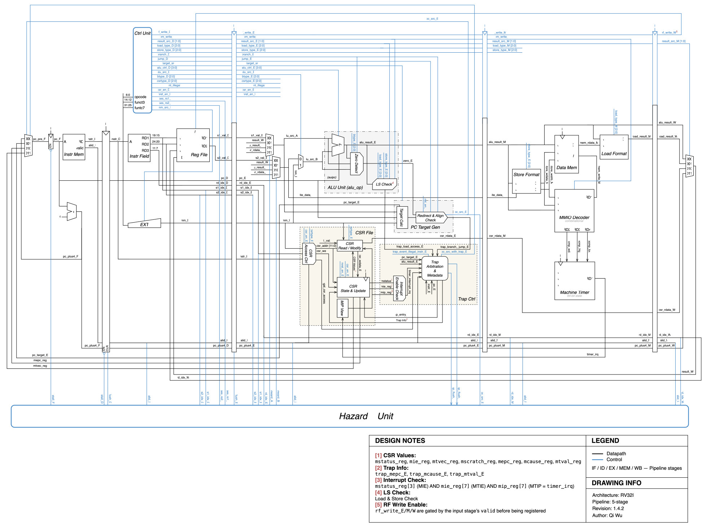

# RISC Pipeline

I'm building a 32-bit, single-issue RISC-V processor in SystemVerilog. It has a
five-stage in-order pipeline with forwarding, load-use stalls, and EX-stage
branch and jump resolution, plus a minimal machine-mode CSR, precise-trap,
and one-shot timer-interrupt path.

I'm using this project to learn CPU design, so I want to be able to explain
what each module owns and how the control decisions fit together. The current
milestone covers the Phase 3 verification baseline and the minimum Phase 4
CSR/trap/timer loop. SoC integration and FPGA bring-up are next, in Phase 5.

## Datapath

[](docs/Datapath_v1.4.2.svg)

[Open the full-size diagram](docs/Datapath_v1.4.2.svg) for signal labels and design
notes. Black paths carry data; blue paths carry control. Follow the main
pipeline from left to right, with forwarding and PC redirects returning to
earlier stages and hazard control running along the bottom.

The [architecture walkthrough](docs/core-architecture.md#datapath-overview)
connects the drawing to pipeline stages, RTL modules, and control priorities.

## Implemented Features

| Area | Current implementation |
| --- | --- |
| Pipeline | `IF` / `ID` / `EX` / `MEM` / `WB`, with four explicit pipeline registers carrying `valid` bits |
| Integer execution | Register and immediate ALU operations, all six base branch conditions, `jal`, `jalr`, `lui`, and `auipc` |
| Memory | Byte, halfword, and word loads and stores in internal data RAM; separate instruction memory |
| Hazards | MEM/WB-to-EX forwarding, CSR-result forwarding, load-use stalls, and redirect flushing |
| CSR access | All six base Zicsr read/modify/write forms for the supported machine-mode CSR set |
| Traps and return | `ecall`, `ebreak`, `mret`, and selected precise synchronous exceptions, with synchronous exceptions taking priority over timer interrupts |
| Timer | A one-shot machine-timer interrupt through MMIO-programmable `mtimecmp` |

See the [CSR, trap, and timer design](docs/csr-trap-design.md) for supported
registers, exception causes, and interrupt behavior.

## Verification and Quick Start

The directed Verilator regression contains seven module tests and twelve
processor smoke tests. These check local datapath and control behavior,
pipeline integration, and selected precise-trap and timer scenarios. A separate
ISA-lite runner executes selected upstream `rv32ui` programs using a local
register-based completion protocol.

The runners expect Verilator, a C++ build environment, and a RISC-V GNU
toolchain exposing `riscv64-elf-*` commands. The ISA-lite flow also requires
an upstream `riscv-tests` checkout at `tools/riscv-tests/`; follow the
[setup instructions](tools/README.md#riscv-tests).

Run the complete directed regression:

```bash
bash sim/run_regression.sh
```

Run the selected upstream ISA-lite tests:

```bash
bash sim/run_isa_lite.sh
```

Run one ISA-lite test:

```bash
bash sim/run_isa_lite.sh ori
```

Waveform tracing is disabled by default. Set `TRACE=1` to generate a VCD
for a test, then open it with GTKWave if installed:

```bash
TRACE=1 bash sim/run_data_mem.sh
gtkwave sim/build/data_mem/data_mem_tb.vcd
```

The same switch works with the regression and ISA-lite runners. See the
[waveform guide](sim/README.md#waveforms) for output paths and examples.

See the [simulation guide](sim/README.md) for build commands and generated-file
locations, and [verification evidence and gaps](docs/verification.md) for the
coverage boundaries.

## Preliminary FPGA Implementation

Two Vivado 2026.1 project-based synthesis and implementation runs targeted
Artix-7 `xc7a100tcsg324-1` at **50 MHz (20 ns)**, using different fixed
instruction ROM images:
[`smoke_alu.hex`](programs/hex/smoke_alu.hex) and
[`smoke_csr_trap.hex`](programs/hex/smoke_csr_trap.hex).

| Metric | `smoke_alu` (2026-11-01) | `smoke_csr_trap` (2026-11-02) |
| --- | ---: | ---: |
| LUTs after synthesis, including LUTRAM | 1344 | 2298 |
| LUTRAM (included above) | 0 | 128 |
| Flip-flops after synthesis | 1451 | 1916 |
| BRAM tiles after synthesis | 0 | 0 |
| Worst setup slack after routing | +2.357 ns | +1.406 ns |
| Worst hold slack after routing | +0.130 ns | +0.114 ns |

With `smoke_alu`, synthesis removed the data RAM, CSR state, and timer
state. With `smoke_csr_trap`, these remained, including a 256-by-32-bit
data RAM mapped to 128 LUTRAMs. The ROM image changes what synthesis can
treat as constant and remove, so these numbers depend on the program. I don't
treat the smaller result as an RTL optimization or either run as proof of
full functional coverage.

In the `smoke_csr_trap` run, the worst setup path runs from EX/MEM
`rd_idx[2]` to the ID/EX `rs2_val[29]` synchronous-clear input.
Its data-path delay is **17.835 ns**, with **75.8%** from routing.
Internal setup, hold, and pulse-width checks passed, with no unclocked
registers, unconstrained internal endpoints, or routing errors.
I haven't tested the core on the FPGA board yet.

## Current Boundaries

- The core implements a practical RV32I teaching subset plus selected Zicsr and
  machine-mode behavior. Full ISA and privileged-architecture compliance remain
  outside the verified baseline.
- Instruction and data memories are internal arrays. A CPU-to-SoC
  request/response interface is the first Phase 5 task.
- Instruction memory holds 256 words. The ISA-lite flow initializes instruction
  memory only; loading ELF data sections into data memory remains future work.
- Timer support is one-shot. Software/external interrupts, nested traps, and a
  general ABI-safe trap runtime remain future work.

The [architecture limitations](docs/core-architecture.md#7-current-boundary-and-known-limitations)
and [verification gaps](docs/verification.md#next-verification-work) give the
full scope.

## Repository Map

| Path | Purpose |
| --- | --- |
| `rtl/core/` | Stage/Hazard Unit connections and shared types, with `stages/`, `pipeline/`, `datapath/`, `control/`, and `csr/` subdirectories |
| `rtl/core/stages/` | Five independent stage modules; each producing stage contains its outgoing pipeline register |
| `rtl/memory/` | Internal instruction and data memories |
| `rtl/peripherals/` | Machine timer |
| `rtl/soc/` | Top-level wrapper, MMIO decoder, and system address map |
| `rtl/filelist.f` | RTL compilation list, with packages listed before their users |
| `tb/` | Directed SystemVerilog module and processor testbenches |
| `programs/` | `asm/` for local assembly sources; `hex/` for instruction images |
| `sim/` | Build and test runners |
| `software/` | Linker script, minimal runtime, ISA-lite environment, and build helpers |
| `docs/` | Datapath diagram, architecture, design rationale, verification notes, tool notes, and backlog |
| `docs/plans/` | Phase-by-phase roadmap and exit criteria |
| `tools/` | External tool or test-suite checkouts that are not owned by this repository |

These directories group source files by responsibility. The current core still
instantiates the internal memories, MMIO decoder, and timer; moving their
integration into the SoC is part of the Phase 5 interface work.

## Documentation

- [Datapath diagram](docs/Datapath_v1.4.2.svg)
- [Core architecture](docs/core-architecture.md)
- [Verification strategy and evidence](docs/verification.md)
- [CSR, exceptions, and machine-timer design](docs/csr-trap-design.md)
- [Data-memory addressing notes](docs/data-memory-addressing.md)
- [Phased implementation plan](docs/plans/README.md)
- [Deferred ideas](docs/backlog.md)
- [Tool-chain notes](docs/tool-chain-notes/)

[AGENTS.md](AGENTS.md) defines a teaching-first AI collaboration workflow: the
author leads design, implementation, and validation, with AI supporting
explanations, design discussions, and review. [agent_context.md](agent_context.md)
provides a concise project map, current status, and technical boundaries.

## Project Direction

I plan to tackle the next steps in this order:

1. Freeze the CPU-to-SoC request/response contract.
2. Integrate a minimal SoC and bring it up on the NEXYS Artix-7 board.
3. Establish a system-level software and verification baseline.
4. Add Cache and FPU, followed by lightweight RTOS integration.

These are planned milestones. See the [phase plans and exit criteria](docs/plans/README.md#phase-list)
for their dependencies and completion standards.

Future ideas that are worth keeping but are not active work belong in
[`docs/backlog.md`](docs/backlog.md).
