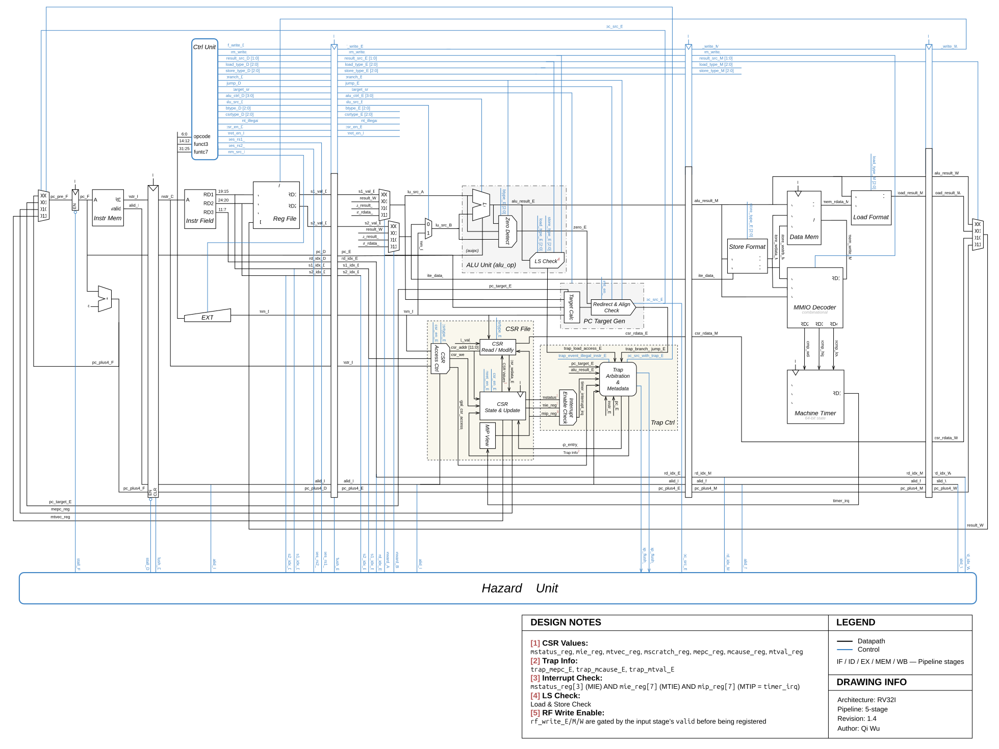

# Core Architecture

This document describes the architecture that exists in the current RTL. It
is a reader-facing overview of the whole core; detailed trap behavior and test
strategy live in their own documents.

## Datapath Overview

[](Datapath_v1.4.svg)

[Open the full-size diagram](Datapath_v1.4.svg) to read the signal labels and design
notes. Black lines carry data and blue lines carry control. The drawing uses
`F`, `D`, `E`, `M`, and `W` suffixes for Fetch, Decode, Execute, Memory, and
Writeback.

Read the drawing in three passes:

1. Follow an instruction from the PC and instruction memory through Decode,
   Execute, Memory, and Writeback. The four vertical pipeline registers carry
   its data, control, and validity between stages.
2. Trace the MEM and WB feedback paths into the EX operand muxes. The Hazard
   Unit at the bottom selects forwarding sources and controls stalls and
   flushes; the sections below explain the priority rules.
3. Follow the redirect paths back to the PC mux. `pc_target_gen.sv` handles
   branch/jump targets and target alignment, `trap_ctrl.sv` arbitrates traps and
   produces metadata, and `csr_file.sv` owns the saved state used by trap entry
   and `mret`.

The CSR Access Ctrl, CSR Read/Modify, CSR State & Update, and MIP View blocks
describe internal responsibilities of `csr_file.sv`. Interrupt-enable checks
and trap arbitration belong to `trap_ctrl.sv`. The drawing separates these
responsibilities visually; [core.sv](../rtl/core/core.sv) wires the actual
modules together, using the bundles in
[core_types_pkg.sv](../rtl/core/core_types_pkg.sv).

## 1. Design Boundary

The processor is a 32-bit, in-order, single-issue pipeline organized around
five stages: `IF`, `ID`, `EX`, `MEM`, and `WB`. It targets a practical RV32I
teaching subset and adds the minimum machine-mode CSR, trap, and timer behavior
needed for the next SoC phase.

The current top-level integration is `rtl/core/core.sv`. `rtl/soc/top.sv` is a
thin wrapper and remains the future handoff point for board- and SoC-level
integration.

The design favors explicit modules and visible control signals. This makes the
pipeline easier to inspect and explain, even when that costs a little more
wiring in `core.sv`.

### RTL Source Organization

| Path under `rtl/` | Responsibility |
| --- | --- |
| `core/` | Core integration in `core.sv` and shared types in `core_types_pkg.sv` |
| `core/pipeline/` | The four pipeline registers: `IF_ID`, `ID_EX`, `EX_MEM`, and `MEM_WB` |
| `core/datapath/` | ALU, register file, immediate and instruction-field extraction, PC logic, operand/writeback muxes, and load/store formatting |
| `core/control/` | Instruction decode and hazard control |
| `core/csr/` | CSR state and trap arbitration, kept in separate modules |
| `memory/` | Internal instruction and data memory arrays |
| `peripherals/` | Machine timer |
| `soc/` | Top-level wrapper, MMIO decoder, and system address map |

Integrated simulations and editor lint use [rtl/filelist.f](../rtl/filelist.f).
Its paths are relative to the repository root, and packages precede the modules
that import them. Module tests list only their required source files.

This layout groups files by responsibility. The current `core.sv` still wires
the internal memories, MMIO decoder, and timer together. Moving that integration
to the SoC layer requires the Phase 5 CPU request/response contract.

## 2. Pipeline Stages

| Stage | Main work | State passed forward |
| --- | --- | --- |
| `IF` | Hold the PC, fetch one 32-bit instruction, and compute `PC + 4` | PC, instruction, and `PC + 4` |
| `ID` | Decode control, read the register file, extract register fields, and generate the immediate | Source values and indexes, destination index, immediate, instruction metadata, and control |
| `EX` | Apply forwarding, select ALU operands, compute ALU results and addresses, resolve branch/jump targets, execute CSR operations, and arbitrate traps | ALU result, store data, destination index, `PC + 4`, CSR read data, and reduced control |
| `MEM` | Format stores, decode timer MMIO, access data memory, and extract or extend load data | ALU result, load result, destination index, `PC + 4`, CSR read data, and writeback control |
| `WB` | Select the final result and write the register file | Architectural register-file update |

The four pipeline registers carry explicit `valid` bits. Flushes insert bubbles
by clearing validity and side-effecting controls rather than allowing wrong-path
or faulting instructions to continue.

## 3. Control Ownership

The core keeps detection, policy, state, and redirection separate:

| Block | Responsibility |
| --- | --- |
| `control_unit.sv` | Decode instructions and produce the Decode-stage control bundle |
| `hazard_unit.sv` | Choose forwarding sources and generate pipeline stall/flush controls |
| `alu_op.sv` | Execute integer operations, evaluate branches, form data addresses, and classify load/store misalignment |
| `pc_target_gen.sv` | Form branch/jump targets, decide normal redirects, and classify instruction-target misalignment |
| `trap_ctrl.sv` | Select the authoritative exception or interrupt and produce trap metadata and flush requests |
| `csr_file.sv` | Own persistent CSR state and apply CSR, trap-entry, and `mret` updates |
| `pc_mux.sv` | Select sequential, normal redirect, `mret`, or trap-entry PC values |

This split is intentional. A detection block reports what happened; it does
not also decide global priority or mutate architectural state.

## 4. Hazard and Redirect Rules

Both EX operands can use their original ID/EX values, a MEM-stage ALU result, a
MEM-stage CSR result, or the WB result. A MEM-stage load is not forwarded
directly because its data is not available early enough for the immediately
following EX-stage consumer.

When a valid EX-stage load writes a nonzero destination used by the valid
Decode-stage instruction, the core stalls Fetch and Decode and flushes Execute
for one cycle. This inserts the bubble needed before WB forwarding can satisfy
the dependency.

Branches and jumps are resolved in EX. A taken redirect flushes the younger
instructions in Decode and Execute. `mret` uses the same redirect mechanism.
An accepted trap has priority over the ordinary redirect path and over a
load-use stall.

The practical priority is:

```text
accepted trap
  -> taken branch, jump, or mret
  -> load-use stall
  -> normal flow
```

## 5. Precise Trap Boundary

The current precise boundary is the instruction in EX. When a synchronous
exception or enabled timer interrupt is accepted:

```text
older instruction in MEM  -> may complete once
current instruction in EX -> does not enter MEM or commit
younger instructions      -> are flushed
```

For a synchronous exception, `mepc` records the faulting instruction. For the
timer interrupt, the legal EX instruction is squashed and its PC is saved so
`mret` can re-execute it. Synchronous exceptions take priority over the timer
request at the same boundary.

See [`csr-trap-design.md`](csr-trap-design.md) for CSR masks, trap causes,
metadata rules, and timer details.

## 6. Memory and MMIO

The current instruction and data memories are internal word arrays that receive
byte addresses from the core. The low address bits select a byte lane or are
dropped when indexing the word array. Byte and halfword access formatting is
split between `store_data.sv` and `load_data.sv`.

Data memory is not cleared by CPU reset. Memory initialization and CPU reset
are separate responsibilities, which also keeps the RTL compatible with later
RAM inference.

The first MMIO path recognizes two aligned full-word store addresses for the
low and high halves of `mtimecmp`. `mmio_decoder.sv` routes those writes away
from data RAM, and `machine_timer.sv` owns `mtime`, `mtimecmp`, and the timer
request.

The core does not yet expose a request/response memory interface. Freezing that
boundary is the first Phase 5 architecture task because SoC peripherals, FPGA
memory, and the later Cache all depend on it.

## 7. Current Boundary and Known Limitations

The current RTL and tests establish a focused baseline, not complete ISA or
privileged compliance. Important limitations include:

- No external request/response memory interface or SoC wrapper
- No software or external interrupts
- No vectored `mtvec`, nested traps, or production-quality context-save runtime
- Timer support is one-shot; periodic scheduling is not implemented
- Upstream ISA-lite tests do not initialize data memory from ELF sections
- Instruction memory is currently limited to 256 words
- Program-level exception coverage is directed rather than exhaustive
- Cache, FPU, FPGA integration, and RTOS support remain future phases

These limitations are deliberate scope boundaries. New features should keep
the five-stage behavior explainable and preserve the existing regression.

## 8. Source of Truth

Use the documents according to their roles:

- This file explains the whole-core architecture.
- [`Datapath_v1.4.svg`](Datapath_v1.4.svg) provides the visual map of data and control flow.
- [`csr-trap-design.md`](csr-trap-design.md) owns CSR, exception, and interrupt rationale.
- [`verification.md`](verification.md) owns verification strategy and evidence.
- [`plans/README.md`](plans/README.md) owns the project goals, completion
  standard, and phased roadmap.

When a document conflicts with the implementation, trust the RTL and the
current regression, then update the document.
